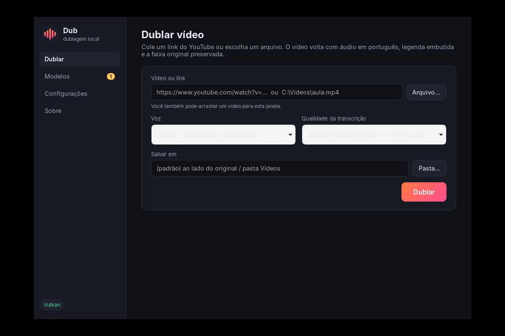

# Dub_Aud_Vid

[](https://github.com/LJCGJ/Dub_Aud_Vid/actions/workflows/ci.yml)
[](https://github.com/LJCGJ/Dub_Aud_Vid/releases)

Dublagem automática de vídeos com IA, 100% local. Recebe um vídeo (arquivo ou
URL do YouTube) em inglês e devolve o mesmo vídeo com uma faixa de áudio em
PT-BR — voz dublada por cima da trilha original, áudio original mantido como
segunda faixa e legenda embutida, como no YouTube.

```
dub                                                 # assistente: menus com as setas (fonte, CPU/GPU, modelo, voz, saída)
dub models download                                 # whisper medium + voz pt_BR-faber + tradutor en→pt (~1,8 GB)
dub video "https://www.youtube.com/watch?v=..."     # 100% nativo: whisper.cpp → CTranslate2 → Piper → remux
dub video aula.mp4 --whisper-model large-v3-turbo-q5_0 --voice pt_BR-edresson-low
dub video aula.mp4 --tts kokoro --voice pf_dora     # TTS via Python (opcional)
dub doctor
```

**Começo rápido (Windows):** baixe o instalador `Dub_*_x64-setup.exe` da
[última release](https://github.com/LJCGJ/Dub_Aud_Vid/releases), abra o Dub, vá em
*Modelos* → *Baixar conjunto padrão* (uma vez) e cole o link do vídeo. O instalador
já traz ffmpeg, yt-dlp, onnxruntime e os dados do espeak-ng — não precisa de Python.



## Requisitos

| Sistema | Suporte | Observações |
|---|---|---|
| Windows 10 / 11 (x64) | ✔ instalador `.exe` | WebView2 já vem com o Windows. **Windows 7/8 não são suportados** (Rust, ONNX Runtime e WebView2 exigem Windows 10+). |
| macOS (Apple Silicon) | ✔ `.dmg` | Instale o ffmpeg: `brew install ffmpeg`. Macs Intel: compile localmente (`--target x86_64-apple-darwin`). |
| Linux x64 | ✔ `.deb` / `.AppImage` | Ubuntu 22.04+ / Debian 12+; precisa de `ffmpeg` e `webkit2gtk`. |

- **CPU:** x86-64 com **AVX2** (Intel a partir de 2013 / AMD Ryzen). Os binários da release são compilados nesse nível (`native/cmake/ggml-portable.cmake`); quem compila localmente ganha otimização para a própria CPU.
- **RAM:** 8 GB (whisper `medium` + tradutor + voz ocupam ~3 GB durante a dublagem). Com `large-v3`, 16 GB.
- **Placa de vídeo: não é necessária.** Tudo roda na CPU. Se houver uma, o instalador do Windows a usa **automaticamente**, sem instalar CUDA: whisper via Vulkan e voz via DirectML — NVIDIA, AMD ou Intel, inclusive placas modestas como uma GT 1030. Se o modelo não couber na VRAM com 20 % de folga, aquela etapa fica na CPU e o app avisa (use `medium-q5_0` ou `small` em placas de 2 GB). Quem compila localmente com NVIDIA pode usar `native-cuda` para o máximo de desempenho.
- **GPU integrada (Intel Iris/UHD, AMD APU):** o whisper roda *mais devagar* nela do que na CPU (ela divide a RAM e tem pouca força de cálculo), então no modo automático a transcrição fica na CPU e só a voz vai para a GPU. Medido numa Iris Xe: whisper `medium` levou 12 min para 3 min de áudio via Vulkan, contra ~2 min na CPU.
- **Onde processar (`--device` na CLI, "Onde processar" no app):** `auto` decide pelo hardware (GPU dedicada faz tudo; integrada só a voz); `split` divide — transcrição na CPU e voz na GPU, em paralelo; `gpu` manda tudo para a GPU; `cpu` ignora a GPU. A tela do trabalho e o `dub doctor` mostram **onde cada etapa roda e por quê**. A tradução fica sempre na CPU.
- **Recomendações calculadas, não fixas:** o assistente da CLI (`dub`) e o app marcam "(recomendado)" em *onde processar*, *uso do hardware*, *modelo do whisper* e *voz* a partir do que foi detectado nesta máquina — GPU integrada ou dedicada, VRAM, RAM livre e núcleos — com o motivo ao lado. `dub doctor` mostra o mesmo.
- **Uso do hardware:** o modo *Equilibrado* (padrão) deixa um núcleo livre e roda com prioridade abaixo do normal, para o PC continuar respondendo; *Econômico* usa metade dos núcleos e nenhuma GPU; *Máximo* usa tudo. Se a RAM livre não comporta o modelo com folga, o app troca por um modelo menor já instalado (e avisa) em vez de deixar a máquina entrar em swap. Nenhum ajuste de clock ou voltagem é feito — a GPU é usada pelas mesmas APIs de um jogo, e o driver controla temperatura e consumo.
- **Disco:** ~2 GB para o conjunto padrão de modelos.
- **Internet:** só para baixar modelos (uma vez) e vídeos do YouTube. A dublagem em si é 100% offline.

## Como funciona

```
 vídeo ─► áudio 16k ─► [demucs] ─► voz ─► [whisper] ─► [pyannote] ─► segmentos
                          │                                            │
                        fundo                             tradução (CPU) ║ síntese (GPU)
                          │                                            │
                          └─────────────► time-fit + mixagem ◄─────────┘
                                                   │
                                        remux: vídeo + dub + original + SRT
```

- **Tradução e síntese rodam em paralelo**: a CPU traduz o lote N enquanto a
  GPU sintetiza o N-1. Sem GPU, tudo roda em CPU automaticamente.
- **Time-fit**: português costuma ficar 15–30% mais longo que inglês. Cada fala
  é acelerada só o necessário (máx. 1.35x por padrão, preservando o tom via
  ffmpeg `atempo`), usando o silêncio seguinte como folga antes de acelerar.
- **Sobreposição de falas**: trechos onde dois falantes se cruzam têm a
  dublagem com volume reduzido para não brigar com a trilha.

## Arquitetura

| Crate | Linguagem | Papel |
|---|---|---|
| `dub-core` | Rust | Tipos, traits das engines, `Backend` (GPU/CPU), pipeline paralelo, time-fit |
| `dub-media` | Rust | ffmpeg/ffprobe/yt-dlp: extração, atempo, remux |
| `dub-engines-py` | Rust | Sobe engines Python como processos e fala JSON-lines com elas |
| `dub-input-video` | Rust | Adaptador vídeo/YouTube (`prepare` → pipeline → `finish`) |
| `dub-native` | Rust + C++ | Engines nativas: WSOLA (C++ via `cxx`), whisper.cpp, CTranslate2, Piper via ONNX Runtime + espeak-ng |
| `dub-models` | Rust | Catálogo e download de modelos (`dub models`) |
| `dub-runtime` | Rust | Compartilhado por CLI e app: resolução de engines (nativa → Python), execução do job com eventos, diagnóstico |
| `dub-cli` | Rust | Comando `dub` |
| `app/` | Rust + HTML/JS | App de desktop (Tauri 2): dublar, progresso por etapa, modelos, configurações |
| `py/dub_engines` | Python | Engines: faster-whisper, Marian/NLLB, Piper, Kokoro, XTTS, Demucs, pyannote |
| `native/timestretch` | C++ | Time-stretch WSOLA (preserva o tom), usado pelo `dub-native` |

O core em Rust **não depende de Python** para compilar ou rodar. Toda engine
fica atrás dos traits `Transcriber`, `Translator`, `Synthesizer`, `Separator` e
`Diarizer`. A CLI resolve cada papel assim:

| Papel | Nativa (Rust/C++) | Python (fallback) |
|---|---|---|
| Transcrição | whisper.cpp (modelo ggml) | faster-whisper |
| Tradução | CTranslate2 (Marian int8) | Marian / NLLB (transformers) |
| Síntese | Piper via ONNX Runtime | Piper / Kokoro / XTTS |
| Separação voz/fundo | MDX-Net (UVR) via ONNX Runtime | Demucs |
| Diarização | — (Parte 2b: sherpa-onnx) | pyannote |
| Time-stretch | WSOLA em C++ | ffmpeg `atempo` (`--ffmpeg-stretch`) |

`--transcriber`, `--translator` e `--tts-impl` aceitam `native | python | auto` para forçar um lado.

## Instalação

Requisitos: Rust 1.75+, **cmake + compilador C++** (Visual Studio Build Tools no
Windows) para as engines nativas, Python 3.10+, ffmpeg no PATH.

> **Máquina com Smart App Control / WDAC** (comum em PC corporativo): o cargo
> não consegue executar os build scripts que compila (`Acesso negado (os error 5)`)
> e nenhum `.exe` não assinado roda. Não há contorno local — compile em um PC
> sem essa política.

```bash
# 1. Build (escolha o backend de GPU da máquina de build)
cargo build --release                                   # CPU
cargo build --release --features native-cuda            # NVIDIA (CUDA Toolkit instalado)
cargo build --release --features native-vulkan          # AMD / Intel / NVIDIA via Vulkan SDK
cargo build --release --features native-directml        # Piper em GPU no Windows (qualquer fabricante)
cargo build --release --no-default-features             # sem engines nativas (só Python)

# 2. Ambiente Python das engines
cd py
python -m venv .venv
.venv/bin/pip install -e ".[basic,kokoro,youtube]"      # Linux/macOS
# .venv\Scripts\pip install -e ".[basic,kokoro,youtube]"  # Windows

# GPU NVIDIA: instale o torch com CUDA ANTES das engines
# .venv/bin/pip install torch --index-url https://download.pytorch.org/whl/cu124

# 3. Confere o que foi detectado
./target/release/dub doctor
```

Extras opcionais:

| Extra | Instala | Para quê |
|---|---|---|
| `separate` | demucs | separar voz do fundo (recomendado; GPU ajuda muito) |
| `diarize` | pyannote.audio | identificar falantes — exige `HF_TOKEN` e aceitar os termos do modelo no Hugging Face |
| `clone` | coqui-tts (XTTS v2) | clonar a voz do falante original (GPU recomendada; licença não comercial) |

## Modelos e pacotes de voz

`dub models list` mostra o catálogo; `dub models download [nomes]` baixa para a
primeira pasta gravável entre `DUB_MODELS_DIR`, `<exe>/models` (layout portátil
do zip) e `~/.cache/dub` (`%LOCALAPPDATA%\dub` no Windows):

```
models/
├── whisper/ggml-medium.bin                       # huggingface.co/ggerganov/whisper.cpp
├── voices/pt_BR-faber-medium.onnx(.json)         # huggingface.co/rhasspy/piper-voices
└── translate/opus-mt-tc-big-en-pt-ct2-int8/      # release models-v1 deste repositório
```

Os tradutores são modelos Marian do Helsinki-NLP convertidos para CTranslate2
int8 pelo workflow `models.yml` (`scripts/convert_translator.py`) e publicados
na release `models-v1`. Para adicionar um par de idiomas, inclua-o na matriz do
workflow e no catálogo (`crates/dub-models/src/catalog.rs`).

- **Piper** (padrão, nativo): `--voice pt_BR-faber-medium` (masc.) ou
  `pt_BR-edresson-low`. Um pacote de voz = `.onnx` + `.onnx.json`.
  Precisa da `onnxruntime` (DLL ao lado do exe, `DUB_ORT_LIB`, ou a do pacote
  Python `onnxruntime`) e da pasta `espeak-ng-data` (ao lado do exe,
  `DUB_ESPEAK_DATA`, ou a do pacote Python `piper-tts`). O `dub doctor` mostra
  o que foi encontrado.
- **Kokoro** (Python): `--tts kokoro --voice pf_dora` (fem.) / `pm_alex`, `pm_santa`.
- **XTTS** (Python, clonagem): `--tts xtts`. Usa o próprio trecho do falante como referência.

## Uso

```
dub video <arquivo|url> [opções]

  --out <arquivo>          saída (padrão: <título>.dub.pt-BR.mp4)
  --from en --to pt-BR     idiomas
  --cpu                    força CPU
  --transcriber auto       auto | native | python
  --whisper-model medium   tiny | base | small | medium | large-v3 | caminho ggml-*.bin
  --translator auto        auto | native | python
  --translator-model <x>   nativo: pasta CT2 (padrão opus-mt-tc-big-en-pt-ct2-int8); python: marian | nllb
  --tts piper              piper | kokoro | xtts
  --tts-impl auto          auto | native | python (só piper)
  --voice <nome|.onnx>     padrão: pt_BR-faber-medium
  --ffmpeg-stretch         atempo do ffmpeg em vez do WSOLA nativo
  --no-separate            desliga a separação voz/instrumental
  --separator-model NOME   Kim_Vocal_2 (padrão) | UVR-MDX-NET-Inst_HQ_3 | arquivo.onnx | demucs
  --no-diarize             desliga pyannote
  --no-original-track      não manter o áudio original
  --no-subtitles           não embutir SRT
  --background-gain 0.9    volume do fundo
  --max-speed 1.35         aceleração máxima da fala
  --voice auto             auto (♂/♀ por trecho) | pt_BR-faber-medium… (Piper) | pf_dora, pm_alex, pm_santa (Kokoro)
  --voice-male / --voice-female   vozes usadas pelo modo auto (padrão: faber / pf_dora)
  --device auto            auto | cpu | gpu | split (onde cada etapa roda)
  --performance balanced   eco | balanced | max (quanto do hardware usar)
  -v / -vv                 logs
```

Arquivos intermediários ficam em `dub_work/<título>/` (áudio extraído, voz e
fundo separados, cada segmento sintetizado, `dub_mix.wav`, e duas legendas:
`dub.srt` com a tradução e `dub.src.srt` com o texto reconhecido no idioma
original — útil para ver se um erro nasceu no ouvido ou na tradução).

**Uma voz por falante, parecida com a original (padrão):** com `--voice auto`
o pipeline agrupa os trechos por falante (diarização, ou — sem ela — por faixa
de tom), escolhe entre as vozes disponíveis a do mesmo gênero com o tom mais
próximo (pf_dora ♀ ≈ 188 Hz; pm_alex ≈ 130, pm_santa ≈ 135, faber ≈ 188 ♂),
e ainda ajusta cada trecho à voz original: desloca o tom até o f0 medido (até
±4 semitons, com o WSOLA) e inclina o espectro na direção do brilho original.
Não é clonagem — é uma aproximação, como a dublagem automática do YouTube.
A mixagem preserva o estéreo do instrumental, com a dublagem no centro, e o
início/fim de cada frase é alinhado ao instante em que a voz original soa.

**Voz masculina ou feminina, automaticamente:** as quatro vozes
pt-BR do Piper são masculinas; a voz feminina vem do **Kokoro** (82M, ONNX, no
mesmo ONNX Runtime — `pf_dora`; também `pm_alex`/`pm_santa`). Com
`--voice auto`, o pipeline estima o tom (f0, método YIN) de cada trecho na voz
isolada — abaixo de 165 Hz masculino, acima feminino — e, com diarização, vota
por falante para a voz não trocar no meio de uma fala. O modelo Kokoro
(197 MB) faz parte do conjunto padrão.

**Separação voz/instrumental (padrão):** o modelo MDX-Net `Kim_Vocal_2` (do
Ultimate Vocal Remover, em ONNX, no mesmo ONNX Runtime do Piper — CPU ou GPU)
isola a voz original; a dublagem entra por cima do **instrumental**, então
música, efeitos e ambiente ficam intactos — é o que permite dublar músicas e
jogos. O whisper também ouve a voz isolada, o que melhora a transcrição com
música alta. O modelo faz parte do conjunto padrão (`dub models download`,
64 MB); `--separator-model` troca o modelo (`UVR-MDX-NET-Inst_HQ_3`, um
`.onnx` próprio, ou `demucs` para a engine Python). Sem modelo instalado ou
com `--no-separate`, o original inteiro entra como fundo e é abaixado só
enquanto a voz dublada fala.

## App de desktop

```bash
cargo run -p dub-app                 # desenvolvimento (precisa de webkit2gtk no Linux)
npm i -g @tauri-apps/cli && cd app && tauri build   # instalador (NSIS/dmg/deb/AppImage)
```

O app lê os recursos empacotados (`onnxruntime`, `espeak-ng-data`, `ffmpeg`,
`yt-dlp`) da pasta de instalação e os modelos de `%LOCALAPPDATA%\dub` /
`~/.cache/dub`. Preferências ficam em `settings.json` na pasta de configuração
do usuário. O frontend é HTML/CSS/JS puro (`app/ui/`), sem bundler.

## Desenvolvimento

```bash
cargo test --workspace        # inclui teste ponta a ponta com engines mock em Python
cargo clippy --workspace --all-targets -- -D warnings
cargo fmt --all
dub video teste.mp4 --mock    # roda o pipeline inteiro com engines falsas, sem modelos
```

CI (`.github/workflows/ci.yml`) roda testes, clippy e um smoke test da CLI em
Linux, Windows e macOS a cada push. `git tag v0.1.0 && git push --tags` dispara
`release.yml`, que publica zips por plataforma com `dub`, `onnxruntime` e
`espeak-ng-data`.

Para adicionar uma engine Python: crie a classe em `py/dub_engines/engines/`,
registre em `registry.py` e implemente os métodos do protocolo
(`py/dub_engines/protocol.py`). Nenhuma mudança em Rust é necessária.

## Roadmap

- [x] **Parte 1** — core, pipeline paralelo, engines Python, CLI, adaptador vídeo/YouTube
- [x] **Parte 2** — WSOLA em C++, whisper.cpp nativo, Piper nativo (ONNX Runtime + espeak-ng), fallback nativa → Python
- [x] **Parte 2b** — tradução nativa (CTranslate2), `dub models`, CI em 3 SOs, releases por tag, workflow de conversão de modelos. Fluxo principal 100% sem Python
- [x] **Parte 3** — app Tauri (dublar, progresso, modelos, configurações, diagnóstico), instalador Windows/macOS/Linux com ffmpeg + yt-dlp + onnxruntime + espeak-ng-data embutidos
- [ ] **Depois** — voz por falante (exige diarização), separação (demucs.cpp) e diarização (sherpa-onnx) nativas, adaptador GameDub

## Política de assinatura de código

Os binários do Windows (`Dub_*_x64-setup.exe`, `dub-app.exe`, `dub.exe`) são
construídos exclusivamente pelo GitHub Actions a partir deste repositório
(`.github/workflows/release.yml`) e assinados pelo programa de código aberto do
SignPath. *Free code signing provided by [SignPath.io](https://signpath.io),
certificate by [SignPath Foundation](https://signpath.org).* Guia de
configuração: [docs/assinatura-de-codigo.md](docs/assinatura-de-codigo.md).

**Equipe e papéis**

| Papel | Membro |
|---|---|
| Committer / mantenedor | [@LJCGJ](https://github.com/LJCGJ) (Leonardo Gonzaga) |
| Revisor | [@LJCGJ](https://github.com/LJCGJ) |
| Aprovador de assinaturas | [@LJCGJ](https://github.com/LJCGJ) |

Contribuições externas (pull requests) são revisadas por um mantenedor antes de
entrar, incluindo mudanças em workflows e scripts de build.

**Privacidade**

O Dub não envia dados a nenhum servidor por conta própria e não coleta
telemetria. Acessos à rede acontecem apenas quando você pede: baixar modelos
(GitHub Releases deste repositório e Hugging Face) e baixar vídeos do YouTube
via yt-dlp. A dublagem roda inteiramente no seu computador. Componentes de
terceiros incluídos no instalador: ffmpeg/ffprobe (GPL), yt-dlp (Unlicense),
ONNX Runtime (MIT), espeak-ng-data (GPL) e vozes Piper (MIT) — cada um com sua
própria licença, e nenhum deles faz chamadas de rede por iniciativa própria.

## Licença

MIT. Modelos de terceiros têm licenças próprias (XTTS v2: CPML, não comercial).
